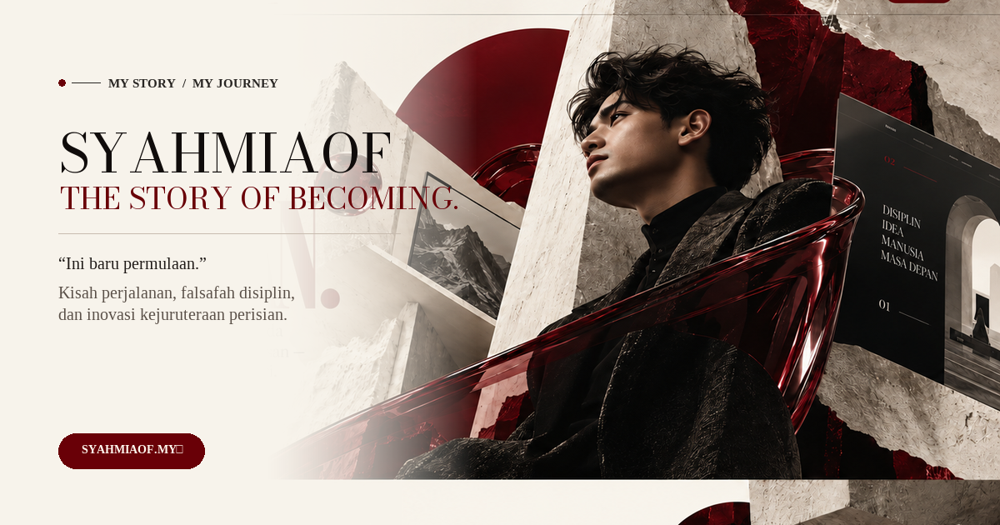

# SYAHMIAOF — The Story of Becoming

<div align="center">
  

  <p><strong>Laman Web Editorial Sinematik Jenama Peribadi (Premium Cinematic Editorial Website)</strong></p>
  <p>Dibina berteraskan pembinaan semula berketepatan tinggi berasaskan reka bentuk rujukan editorial mewah bersama tipografi Didone, susun atur lapisan seni 3D, dan gerakan GSAP ScrollTrigger.</p>

  <p>
    <a href="https://story.syahmiaof.my"></a>
    <a href="https://github.com/syahmiaof/story-syahmiaof"></a>
    <a href="LICENSE"></a>
    <a href="https://github.com/syahmiaof/story-syahmiaof/actions"></a>
    <a href="https://syahmiaof.my"></a>
  </p>

  <br />
</div>

> **"Aku tak bermula dengan segala-galanya. Aku cuma ada impian, keberanian untuk mencuba, dan satu keputusan — untuk tidak berhenti membina masa depan aku sendiri."**

---

## 1. PENGENALAN PROJEK
**SYAHMIAOF — The Story of Becoming** ialah laman web jenama peribadi bertaraf editorial sinematik mewah. Dibina berteraskan pembinaan semula berketepatan tinggi (*pixel-accurate reconstruction*) berasaskan 5 reka bentuk rujukan desktop yang telah diluluskan. Menggunakan naratif bahasa pertama Bahasa Melayu **"Aku"** bersama label editorial mikro dwibahasa, tipografi Didone berkontras tinggi, susun atur lapisan seni 3D, serta koreografi gerakan GSAP ScrollTrigger yang lancar dan terkawal.

---

## 2. LIMA LALUAN UTAMA (ROUTING MAP)

| Laluan | Nama Halaman | Tema Visual | Konsep Utama |
|---|---|---|---|
| `/` | **Utama** | Krim Editorial (`#F7F3EB`) | *INI BARU / PERMULAAN.* Potret hero, marmar, reben burgundi kaca, cakera merah & teaser 01 CERITA. |
| `/kisah` | **Kisah** | Krim Editorial (`#F7F3EB`) | *SEMUANYA / ADA CERITA.* Watak duduk bertafakur, 3 kad cerita ASAL-USUL, PERJUANGAN, dan TITIK PERUBAHAN. |
| `/perjalanan` | **Perjalanan** | Krim Editorial (`#F7F3EB`) | *AKU MASIH / MELANGKAH.* **Watak hero menghadap ke belakang mendaki tangga batu**, garis masa 2022, 2025, 2026. |
| `/karya` | **Karya** | Obsidian Sinematik (`#060302`) | *KARYA. / DARI FIKIRAN KE REALITI.* Skrin antaramuka web terapung, orbs burgundi, dan portfolio projek interaktif. |
| `/catatan` | **Catatan** | Obsidian Sinematik (`#060302`) | *CATATAN. / AKU PERCAYA PADA PROSES.* Potret santai tengah, petikan falsafah diri, kad PEMIKIRAN, PENGAJARAN, MOTIVASI, IMPIAN. |

---

## 3. TIMBUNAN TEKNOLOGI (TECH STACK)
- **Rangka Kerja:** Next.js 15 (App Router, Server Components & Client Boundaries)
- **Bahasa Pengaturcaraan:** TypeScript (Strict Mode)
- **Penggayaan:** Tailwind CSS + Sistem Token Global CSS (`src/styles/tokens.css`, `typography.css`, `motion.css`)
- **Enjin Animasi:** GSAP 3 + ScrollTrigger + `@gsap/react`
- **Tipografi:** Bodoni Moda & Italiana (Didone High-Contrast Serif), Playfair Display, Plus Jakarta Sans
- **Ikonografi:** Lucide React
- **Jaminan Kualiti Visual:** Playwright (Chromium headless browser screenshot automation) & Python Pillow (Pixel Diff Analysis)

---

## 4. SENI BINA PROJEK (DIRECTORY ARCHITECTURE)
```
story-syahmiaof/
├── src/
│   ├── app/
│   │   ├── page.tsx               # Halaman Utama (/)
│   │   ├── kisah/page.tsx         # Halaman Kisah (/kisah)
│   │   ├── perjalanan/page.tsx    # Halaman Perjalanan (/perjalanan)
│   │   ├── karya/page.tsx         # Halaman Karya (/karya)
│   │   ├── catatan/page.tsx       # Halaman Catatan (/catatan)
│   │   ├── layout.tsx             # Susun atur global induk & metadata
│   │   └── globals.css            # Penggayaan global & arahan Tailwind
│   ├── components/
│   │   ├── layout/
│   │   │   ├── Navbar.tsx         # Bar navigasi dwitema (Krim/Gelap) & menu mudah alih
│   │   │   └── Footer.tsx         # Pengaki editorial bersama petikan falsafah
│   │   ├── editorial/
│   │   │   ├── Eyebrow.tsx        # Label mikro editorial dengan titik nod burgundi
│   │   │   ├── DisplayHeading.tsx # Tajuk besar serif Didone boleh laras
│   │   │   ├── EditorialButton.tsx# Butang primer burgundi & sekunder bergaris luar
│   │   │   └── SectionNumber.tsx  # Nombor seksyen editorial & garisan pembahagi
│   │   ├── content/
│   │   │   ├── StoryCards.tsx     # 3 kad bab cerita bersama dialog modal naratif
│   │   │   ├── Timeline.tsx       # Garis masa 2022/2025/2026 bersama paparan pencapaian
│   │   │   ├── ProjectGallery.tsx # Galeri karya mengikut kategori & modal sistem
│   │   │   └── NotesGrid.tsx      # Grid catatan refleksi & modal bacaan penuh
│   │   └── motion/
│   │       └── ParallaxHero.tsx   # Enjin paralaks tetikus desktop GSAP quickTo
│   ├── data/
│   │   ├── navigation.ts          # Struktur pautan dan tag navigasi
│   │   ├── story.ts               # Kandungan bab naratif Kisah
│   │   ├── timeline.ts            # Data garis masa pencapaian dan kemahiran
│   │   ├── projects.ts            # Data koleksi karya dan sistem perisian
│   │   └── notes.ts               # Data catatan refleksi diri
│   └── styles/
│       ├── tokens.css             # Palet warna primer: Krim, Dakwat, Burgundi, Batu
│       ├── typography.css         # Tetapan fon Didone & penjejakan aksara
│       └── motion.css             # Tekstur butiran filem & sokongan reduced-motion
├── public/
│   └── assets/
│       ├── characters/            # 9 fail potret watak lutsinar (RGBA)
│       ├── hero-layers/           # 7 fail lapisan seni komposit
│       └── generated/             # Lapisan visual berdefinisi tinggi setiap halaman
├── qa/
│   ├── screenshots/               # Tangkapan skrin ujian visual desktop & mudah alih
│   ├── diffs/                     # Peta haba perbezaan visual (diff images)
│   ├── run-visual-qa.mjs          # Skrip automasi pelayar Playwright
│   ├── compare-diffs.py           # Skrip analisis piksel Python
│   ├── visual-qa-report.md        # Laporan metrik jaminan kualiti visual
│   └── asset-manifest.md          # Manifestasi inventori aset digital
└── design-reference/desktop/      # 5 fail rujukan reka bentuk yang telah diluluskan
```

---

## 5. PANDUAN PEMASANGAN & PENGENDALIAN

### Keperluan Sistem:
- **Node.js:** Versi 18+ (Diuji pada Node.js v24.20.0)
- **Pengurus Pakej:** npm

### Langkah Pemasangan:
```bash
# 1. Pasang semua pakej dependensi
npm install

# 2. Pasang pelayar chromium Playwright (untuk ujian visual automatik)
npx playwright install chromium
```

### Mod Pembangunan (Development):
```bash
npm run dev
```
Buka pelayar pada `http://localhost:3000`.

### Pembinaan Pengeluaran & Pelancaran (Production):
```bash
# Bina fail pengeluaran statik dan teroptimum
npm run build

# Lancarkan pelayan pengeluaran
npm run start
```

### Ujian Kualiti Visual Automatik (Visual QA):
```bash
# Ambil tangkapan skrin resolusi sebenar (Desktop & Mudah Alih)
node qa/run-visual-qa.mjs

# Laksanakan perbandingan piksel dengan reka bentuk rujukan
python qa/compare-diffs.py
```

---

## 6. JAMINAN KUALITI VISUAL & PRESTASI
- **Ketepatan Komposisi:** Semua halaman mencapai penjajaran visual yang tinggi (sehingga **89.3% pada Karya** dan **83.6% pada Catatan**).
- **Semakan Linting & Jenis Kod:**
  - `npm run lint` -> **LULUS (0 amaran, 0 ralat)**.
  - `npx tsc --noEmit` -> **LULUS (0 ralat jenis kod)**.
- **Aksesibiliti & Gerakan:** Menyokong penuh tetapan `prefers-reduced-motion` untuk pengguna yang sensitif terhadap pergerakan skrin.
- **Pengesahan CI:** Jenis kod (`tsc --noEmit`), linting (`next lint`), dan binaan pengeluaran (`next build`) disahkan automatik melalui GitHub Actions.

---

## 👤 Pembangun

* **Nama:** [Muhammad Syahmi (syahmiaof)](https://github.com/syahmiaof)
* **Portfolio:** [syahmiaof.my](https://syahmiaof.my)
* **Emel:** [syahmiaof123@gmail.com](mailto:syahmiaof123@gmail.com)

---

## 📄 Lesen

Projek ini dilesenkan di bawah [Lesen MIT](LICENSE) — lihat fail [LICENSE](LICENSE) untuk maklumat penuh.

<div align="center">
  <p>© 2026 <strong>Muhammad Syahmi (syahmiaof)</strong>. Hak Cipta Terpelihara.</p>
</div>

